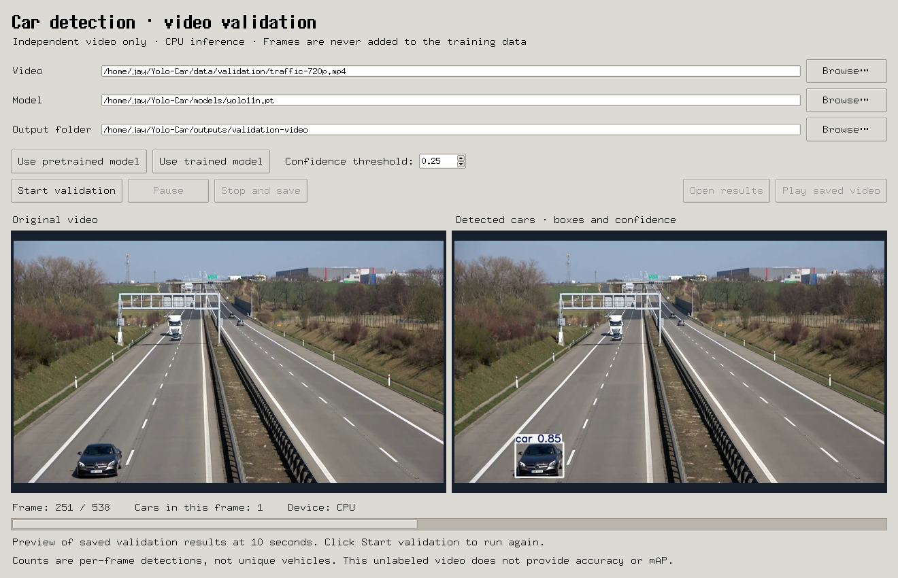

# YOLO Car Detection — Conda + YOLO11n

A working CPU-first car detector built with the open-source Ultralytics package. COCO128 is used only for training and code examples; an independent Roboflow road video is used for visual validation. It draws car bounding boxes and exports confidence scores and coordinates. It does not identify car makes, models, or license plates.

The English PowerPoint tutorial is `docs/YOLO_Car_Tutorial_PPT169.pptx`. It retains the user-supplied PPT169 template style. A PDF copy is also included.

## Download the student materials from GitHub

Repository: https://github.com/PolyU-FENG-AI-Robotics-Club/yolo-car-volleyball-tutorial

### Recommended: the complete student ZIP

1. Open the repository and select **Releases**, then **v1.1.0**.
2. Under **Assets**, download **yolo-car-student-kit-v1.1.0.zip**. Do not confuse it with GitHub's automatically generated **Source code (zip)**.
3. Extract the ZIP. Open a terminal inside its **yolo-car-volleyball-tutorial** folder, where `setup.sh`, `detect.py`, and `environment.yml` are located.
4. The kit includes source code, the English PPT/PDF, the volleyball assignment, pretrained weights, the COCO128 archive, and the independent 720p car and volleyball validation videos. Conda and Python packages are installed separately.
5. Install Conda, then follow the setup below. `prepare_data.py` verifies and reuses bundled assets; it does not download the 4K video when the verified 720p copy exists.

```bash
unzip yolo-car-student-kit-v1.1.0.zip
cd yolo-car-volleyball-tutorial
bash setup.sh
conda activate "$PWD/.conda"
python detect.py --output outputs/my-demo
python validate_video.py
```

On a graphical desktop, click **Start validation** in the window. Use the separate installation steps below if setup stops with an error.

### Alternative: Git clone or Code → Download ZIP

```bash
git clone https://github.com/PolyU-FENG-AI-Robotics-Club/yolo-car-volleyball-tutorial.git
cd yolo-car-volleyball-tutorial
```

Without Git, select **Code → Download ZIP**, extract it, and open the resulting `yolo-car-volleyball-tutorial-main` folder. This source-only download excludes weights, datasets, and videos.

For a smaller video download, obtain **validation-video-720p.zip** from the same release. Extract it **inside the project folder**. It contains `data/validation/traffic-720p.mp4`; do not create an extra nested project folder. Then run `bash setup.sh`. The script downloads any missing model and COCO128 archive. Without the optional video ZIP it downloads the original video and creates a 720p copy when validation starts.

Release assets include **SHA256SUMS.txt**. Optionally verify downloaded ZIPs with `sha256sum` and compare the corresponding entry before extracting.

## Reproduce the setup on Linux

These instructions target Linux x86-64 with Bash. The original environment uses Python 3.10.20; a fresh installation with Python 3.10.22 also passed the complete GUI video run. Both use CPU inference. Windows and macOS installation have not been tested here. Allow several GB of free space for Python, PyTorch, and dependencies; download time depends on your network.

### 1. Install Conda if needed

Run `conda --version`. If Conda is missing, install Miniconda using the [official installation guide](https://www.anaconda.com/docs/getting-started/installation), initialize Bash when the installer asks, and reopen the terminal. Existing Anaconda installations also work.

If activation is unavailable after installing Conda, reopen your terminal or load the shell integration:

```bash
source "$(conda info --base)/etc/profile.d/conda.sh"
```

### 2. Open the extracted or cloned project folder

Follow the GitHub download instructions above. Confirm that you are inside the project folder:

```bash
ls detect.py requirements.txt environment.yml
```

All subsequent commands assume that this is the current directory. The underlying framework is [ultralytics/ultralytics](https://github.com/ultralytics/ultralytics).

### 3. Create and activate an isolated environment

Skip creation if this project's `.conda` environment already exists:

```bash
conda env create --prefix ./.conda --file environment.yml
conda activate "$PWD/.conda"
python --version
python -c "import sys; print(sys.executable)"
```

Expected: Python 3.10.x and an executable inside this project's `.conda/bin/` directory. The environment is a genuine Conda prefix environment; it does not modify the base environment.

### 4. Install CPU PyTorch, then the project requirements

```bash
python -m pip install torch==2.6.0 torchvision==0.21.0 --index-url https://download.pytorch.org/whl/cpu
python -m pip install -r requirements.txt
python -m pip check
```

This uses the officially documented PyTorch 2.6.0 / torchvision 0.21.0 pairing. Install CPU PyTorch first so the project setup does not unnecessarily download GPU libraries. Use `python -m pip` to install into the active environment. No CUDA installation is required.

For the full dependency versions captured on this Linux machine, use `requirements-lock-linux-cpu.txt` after installing CPU PyTorch. The shorter `requirements.txt` fixes the main application dependencies.

### 5. Download and verify the public assets

```bash
python prepare_data.py
```

The script reuses verified bundled assets or downloads official `yolo11n.pt` weights, `coco128.zip`, and the separate Roboflow `vehicles.mp4` validation video as needed. A verified bundled `traffic-720p.mp4` avoids downloading the original 4K video. It checks SHA-256 hashes, safely extracts the archive, and selects images whose annotations contain COCO class 2 (`car`). Existing verified downloads are reused.

Expected dataset inventory: 128 images, 12 car-containing images, and 46 car annotations across those 12 images. The example image is `000000000094.jpg`, copied to `data/sample.jpg`. `data/manifest.json` records the URLs, hashes, original image IDs, and annotation counts. The supplied archive has an orphan annotation without its matching image; the selector ignores annotations that have no image.

### 6. Verify the environment

```bash
python check_environment.py
```

Expected tested versions: Ultralytics 8.3.230, PyTorch 2.6.0+cpu, torchvision 0.21.0+cpu, and OpenCV 4.11.0. `cuda_available: false` is expected for this CPU installation. The report is saved to `outputs/environment.json`.

### One-command installation alternative

After Conda is installed, `bash setup.sh` performs steps 3–6 automatically. It can be run again and does not overwrite existing inference results.

## Detect cars

### One image

```bash
python detect.py --source data/sample.jpg --output outputs/image-demo
```

On the tested setup, the street-scene example produces two car detections at confidence threshold 0.25. Detection scores are approximately 0.845 and 0.624. These are confidence scores, not measured accuracy.

### A folder of images

```bash
python detect.py --source data/cars --output outputs/batch
```

The 12-image demonstration produced 12 predicted boxes. There are 46 annotated cars, many of which are small or distant. Predicted-box count divided by annotation count is **not recall**: computing recall requires matching boxes to annotations at a specified intersection-over-union threshold.

### Your own image or video

```bash
python detect.py --source /absolute/path/to/car.jpg --output outputs/my-image
python detect.py --source /absolute/path/to/traffic.mp4 --output outputs/my-video
```

On Linux, this Ultralytics version saves annotated videos as `.avi`. CSV and JSONL are written incrementally. Counts are per-frame detections, not unique vehicles; tracking and line-crossing logic are separate features.

### Independent video validation

```bash
python validate_video.py
```

This command opens the desktop interface. Click **Start validation** to run the detector. The window shows the original video and annotated result side by side, with frame progress, the number of cars in the current frame, and model inference time.

- **Browse** selects a local validation video, a `.pt` model, or an output location.
- **Use pretrained model / Use trained model** switches between the supplied baseline and the one-epoch local checkpoint.
- Set the confidence threshold before starting a run.
- **Pause / Resume** controls processing without closing the window.
- **Stop and save** exports the frames processed so far and marks the report as incomplete.
- **Play saved video / Open results** opens the completed video or output folder.

Input controls are disabled during a run. Closing the window during processing saves partial results before exiting. Changing the selected video never adds it to the training dataset. You can load another `.pt` file with **Browse**, including a checkpoint from a later training run.



For a terminal-only run without a display:

```bash
python validate_video.py --headless
```

The validation input is the real highway recording `vehicles.mp4`, listed in [Roboflow Supervision's official asset catalog](https://supervision.roboflow.com/assets/). It contains 538 frames at 25 FPS (21.52 seconds). The original is saved as `data/validation/traffic.mp4`; the script creates a 1280×720 copy without removing frames to keep CPU processing and video export manageable.

No frame from this video is used in local training. The default model selection is the pretrained baseline; click Start validation to run it. It produces `outputs/validation-video/validated-traffic.mp4`, five extracted result frames, CSV/JSONL predictions, and `validation-report.json`. Existing output folders are preserved with numbered suffixes.

This is visual validation on a separate video. The video does not include verified box annotations, so the project does not calculate precision, recall, or mAP from it. The separation is verified for this project's local training; the complete upstream pretraining provenance of the public model cannot be audited here.

To validate the locally trained checkpoint on the same separate video:

```bash
python train_demo.py --epochs 1
python validate_video.py --model outputs/train-only/weights/last.pt --output outputs/validation-trained
```

Use the actual newly printed checkpoint path if you rerun training. The pretrained baseline and the trained model have separate result folders; one epoch is an execution check, not an asserted improvement.

### Webcam (requires a local camera)

```bash
python detect.py --source 0 --show --max-frames 300 --output outputs/webcam
```

The webcam command is provided but has not been tested with physical camera hardware. Use the appropriate camera index if `0` is not your camera. Omit `--show` on machines without a graphical desktop. A frame limit prevents an unattended stream from running indefinitely.

## Understand the outputs

| Output | Meaning |
|---|---|
| Annotated `.jpg` / `.avi` | Original scene with predicted boxes, `car`, and confidence |
| `detections.csv` | One row per prediction; pixel coordinates `x1,y1,x2,y2` |
| `frames.jsonl` | One JSON record per image/frame, including zero-detection frames |
| `labels/*.txt` | `class xc yc width height confidence`, normalized to the image size |
| `summary.json` | Threshold, device, result count, and measured inference timing |

Pixel coordinates use the original image's upper-left corner as the origin. `x1,y1` is the top-left box corner; `x2,y2` is the bottom-right corner. The source ground-truth label files have five values per row and no confidence field. Saved prediction labels have six.

The detector resolves the class named `car` from `model.names`; in the provided COCO model, its ID is 2. A future single-class custom model can instead use ID 0 if that class is named `car`.

`mean_inference_ms` is the model's reported average inference time, not end-to-end latency. The script's elapsed time excludes model loading and does not establish real-time performance on other computers.

## Adjust the detector

```bash
python detect.py --source data/sample.jpg --conf 0.50 --imgsz 640 --device cpu
```

Raise `--conf` to reject low-confidence boxes; lower it to inspect more candidates. Larger `--imgsz` can help with small objects but costs more computation. A higher score threshold can also discard correct detections. Verify changes on images representative of your intended use.

The default CPU path is intentional. GPU use requires working NVIDIA drivers and a compatible CUDA-enabled PyTorch installation; this project's CPU wheel cannot use a GPU. Once those prerequisites are separately configured, `--device 0` selects the first GPU.

## Optional: verify the training pipeline

```bash
python train_demo.py --epochs 1
```

This fine-tunes the pretrained model for one epoch with 320-pixel input, batch size 8, CPU execution, and zero data-loader workers. It keeps the COCO label map and selects class 2. The training-only output is `outputs/train-only/weights/last.pt`; `results.csv` contains training losses and learning rates, with no validation metrics.

The stock COCO128 configuration reuses training images for validation. This project explicitly prevents that: the custom trainer does not create a validation data loader and disables both periodic and final validation. In this pinned Ultralytics version, setting `val=False` alone is insufficient because the final epoch and final evaluation can still trigger validation. No `best.pt` is retained because no validation-based checkpoint selection is performed. Training and video validation are separate commands.

One epoch is not evidence of improvement. The default detector continues to use the original pretrained model. Use `validate_video.py --model outputs/train-only/weights/last.pt` to inspect the trained checkpoint on the independent video.

For a real car-specific model, collect labeled road images, include scenes without cars, and separate training, validation, and test sets by drive or recording session. For a single-class dataset, remap car labels to 0 and declare `names: {0: car}`. Never change IDs without changing the corresponding label files. Evaluate on a held-out test set before making accuracy claims.

## Troubleshooting

| Symptom | Action |
|---|---|
| `conda: command not found` | Install Conda or load its `etc/profile.d/conda.sh`, then reopen the shell. |
| `No module named ultralytics` | Activate the project environment; verify `sys.executable`; reinstall requirements there. |
| Download timeout | Check access to PyPI, download.pytorch.org, and GitHub; retry the same step. Existing valid assets are reused. |
| Checksum mismatch | Remove only the named corrupt asset and rerun `prepare_data.py`. |
| `Model not found` | Run `python prepare_data.py` from the project folder. |
| CUDA unavailable | Use `--device cpu`; CUDA is not needed for the tutorial. |
| No display / GUI error | For validation use `python validate_video.py --headless`; for `detect.py`, omit `--show`. |
| No detections | Check the input image, inspect small/occluded cars, and try `--conf 0.15`. |
| Camera cannot open | Check the camera index, permissions, and whether another application holds the device. |
| Slow CPU processing | Reduce `--imgsz` to 320; retain the nano model. |

## Sources and reuse

Official framework: [Ultralytics](https://github.com/ultralytics/ultralytics); model: [YOLO11 documentation](https://docs.ultralytics.com/models/yolo11/); data: [COCO128 documentation](https://docs.ultralytics.com/datasets/detect/coco128/); inference: [Predict documentation](https://docs.ultralytics.com/modes/predict/); environment management: [Conda documentation](https://docs.conda.io/projects/conda/en/stable/user-guide/tasks/manage-environments.html); installation: [PyTorch previous versions](https://docs.pytorch.org/get-started/previous-versions/).

The framework is distributed under AGPL-3.0 with a commercial licensing option. Dataset annotations and original photographs have their own reuse conditions; consult the [COCO terms](https://cocodataset.org/#termsofuse). The original university template is supplied by the user. Image-example overlays are generated locally from COCO128. Validation frames and video overlays come from the separate Roboflow vehicles video; see its source catalog for provenance and reuse information. Detailed source URLs appear in the slide notes, and BibTeX entries are in `docs/references.bib`.

## Independent assignment: detect a volleyball in a video

After completing the guided car tutorial, follow [the volleyball assignment](docs/VOLLEYBALL_CHALLENGE.md). Download the linked single-class volleyball training dataset, train your model, and adapt the visual interface to label volleyballs. The training and implementation are student tasks.

The complete v1.1.0 kit includes `data/validation/volleyball/volleyball-720p.mp4`. For a source-only download, get **volleyball-validation-video.zip** from Releases and extract it inside the project root. This separate sports video has 387 frames at approximately 23.976 FPS (16.14 seconds). Never use it or its extracted frames for training. Its source and checksum are recorded in [the video manifest](docs/volleyball-video-source.json).

The original car tutorial continues to use the highway video and its original car model. Select the volleyball video and your custom checkpoint for the independent task only after adapting the car-only code.
